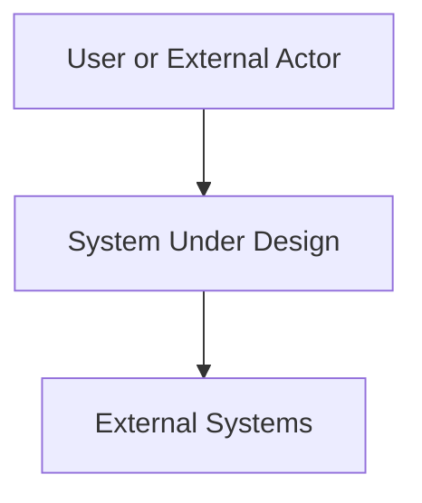
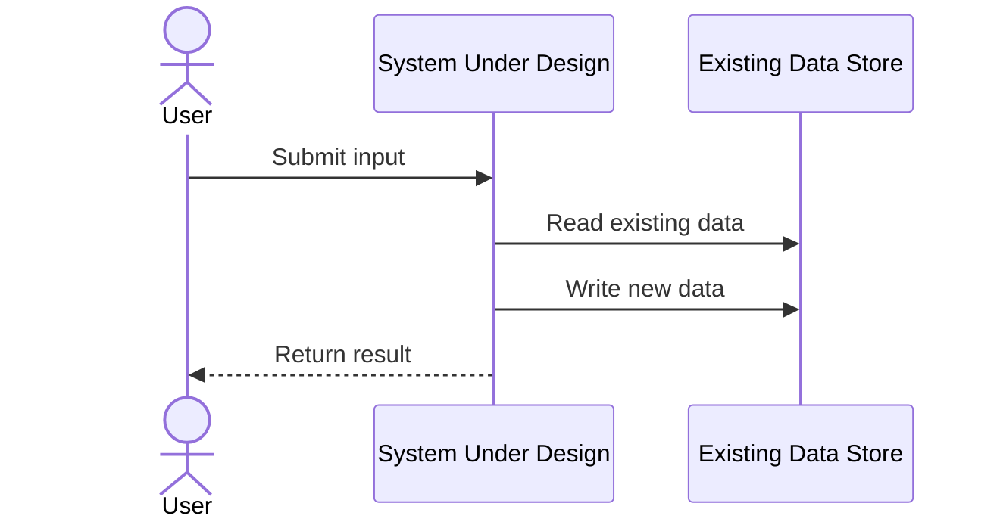
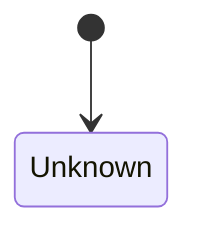
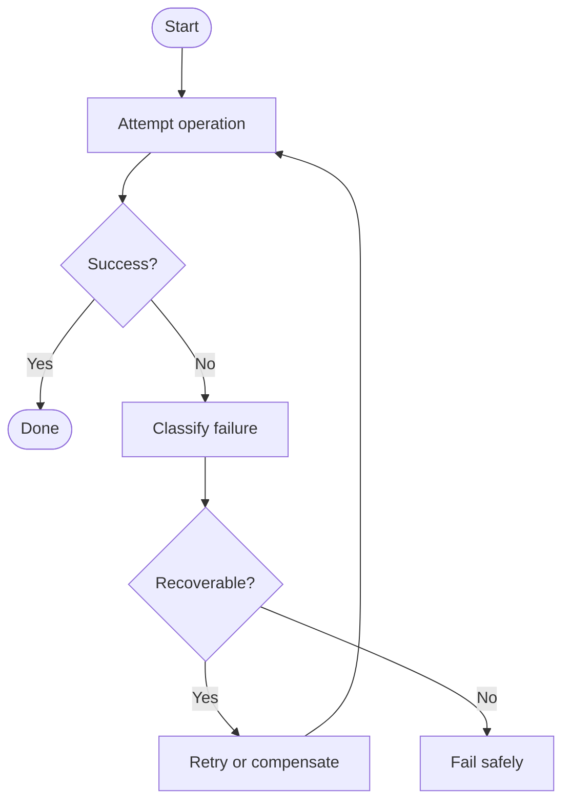

<!--
Concision guidance:
- State each canonical fact once in its home section and cross-reference it
  elsewhere. Do not restate success criteria, bounds, or determinism claims.
- Scale section depth to feature complexity. For a small feature, a section may
  hold a brief "not applicable" or "trivial" note instead of a full expansion.
- Move dense Alloy listings and verification matrices to the Appendices when the
  main sketch grows long. Keep the main body readable.
- Do not drop required sections or reduce failure-mode and risk coverage to save
  space.
-->

# Kickoff Sketch

## Motivation

## Evolution And Future Change

### Grand Vision

### Likely Evolution Paths

### Architectural Seams And Extension Points

### Compatibility And Migration Concerns

### Evolution Fitness Functions

## Scope

### In Scope

### Out Of Scope

## Context

### Background

### Affected Systems And Stakeholders

### Assumptions And Dependencies

### Constraints

### References

## System Boundary



## Inputs, Reads, Writes, And Outputs

### User-Supplied Data

### Data Shape, Transport, And Semantics

### Existing Data Read

### New Data Written

### Outputs

### External Effects

### Sensitive Data And Leakage



## Domain Model

### Entities

### Relationships

### Responsibilities

### Domain Rules

### Invalid States

```alloy
// Structural model fragment.
// Replace these placeholders as the domain model becomes clear.
sig Entity {}

pred show {}
run show for 3
```

## State Machines

### States

### Events

### Commands

### Legal Transitions

### Illegal Transitions

### Retry And Recovery Behavior

### Ordering Guarantees



```alloy
// Behavioral model fragment.
// Add var state, init, event predicates, frame conditions, stutter,
// and transition facts once lifecycle behavior is known.
```

## Algorithmic Core And Data Structures

### Screening Result

### Algorithmically Interesting Operations

### Expected Input Sizes And Explicit Bounds

### Runtime Complexity

Record Big-O time complexity for every algorithmic or data-structure choice. Include expected-case and worst-case complexity when they differ.

### Space Complexity

Record Big-O space complexity for every algorithmic or data-structure choice. Include memory growth bounds and retention assumptions.

### Data Structures And Indexes

### Memory And Streaming Behavior

### I/O, Caching, And Batching Strategy

### Determinism, Ordering, And Tie-Breaking

### Algorithmic Invariants And Edge Cases

### Alternatives Considered

### Simulation, Benchmark, Or Back-Of-The-Envelope Candidates

## Preconditions, Postconditions, And Invariants

### Preconditions

### Postconditions

### Invariants

```alloy
// Invariant assertions and checks.
// Example shape:
// assert InvariantName { all e: Entity | some e }
// check InvariantName for 3
```

## Safety And Liveness Claims

### Safety Claims

### Liveness Claims

### Fairness Assumptions

```alloy
// Safety and liveness checks where appropriate.
// Add liveness only when fairness assumptions are explicit.
```

## Failure Modes



## Quality Attributes

### Utility Tree

### Tradeoffs

### Back-Of-The-Envelope Analysis

### Security And Connectivity Characteristics

### Deterministic Core And Edge Nondeterminism

### Architectural Separation

### Resource Limits And Backpressure

### Dependency Attack Surface

### Simulation Candidates

## Design Implications

## Progressive Review Notes

### Completeness

### Consistency

### Risks

### Alternatives

### Decisions To Revisit

## Alloy Findings

### Alloy Feedback To The Engineer

For each Alloy run, explain:

- The design idea that was modeled.
- The surprising or useful result (Phase A discovery or Phase B counterexample).
- The gap that remains.
- The next design question caused by the result.

### What Alloy Revealed

List gaps, reachable states, illegal-but-currently-legal transitions, and bad
states the model exposed that were not in the engineer's answers. Link each to
the invariant, failure mode, or Open Question it produced. If Alloy revealed
nothing new this round, say so. A model that reveals nothing may be too
tautological to teach anything.

### Alloy Coverage Matrix

### Checks Run

### Counterexamples

### Formal Evidence Self-Audit

For each Alloy `check` and `assert`, record the self-audit result before the
verification plan:

- Independent of its facts? (a check that restates a fact is not evidence)
- SAT witness of the bad state with the mitigation removed?
- Bad state reachable from `init`, or clearly labeled structural-only?

Note each check as meaningful, weak, or a declared gap, with a one-line reason.

### Formal Evidence Quality

State whether each result is actual bounded evidence or only a candidate model,
especially when Alloy could not run. Name any check that is weak and why.

### Model Gaps

### Gaps Or Ambiguities

### Follow-Up Questions

## Verification Plan

### V1 Guarantees

### Accepted Risks

Each accepted risk needs one of: a mitigation, a warning contract, a future
fitness function, or an explicit non-goal.

## Open Questions

## Appendices

Move dense Alloy listings, full verification matrices, and long tables here when
the main sketch grows long. The main body should stay readable and reference
these appendices.
