# OpenSpec Markdown Reader

**Read your specs as documents, not text files. Explore your models as running systems.**

[](#quick-start)
[](manifest.json)
[](LICENSE)

OpenSpec Markdown Reader is a Firefox extension for spec-driven development and verified coding.

Open a local `spec.md`, Alloy model, or Java/OpenJML source at its `file:///` URL.
The extension shows it as a structured, navigable document: requirements and scenarios as cards, EARS and RFC 2119 keywords highlighted, rendered Mermaid diagrams, and foldable code. From an Alloy block, one click opens an interactive trace explorer.

The plugin is designed for local-first development -- nothing is hosted or uploaded. Your files stay where they are.

<picture>
  <source media="(prefers-color-scheme: dark)" srcset="docs/images/hero-dark.png">
  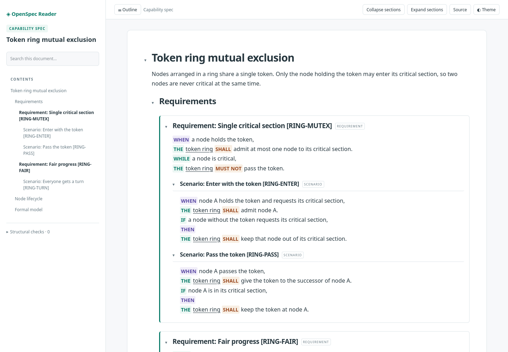
</picture>

## Motivation

Spec-driven development requires a few critical ingredients:
- A robust [coding agent configuration](.opencode/) with strong steering support.
- A [specification format](https://github.com/ohpauleez/openspec_srs-driven) with:
  - A high-level context description (explaining "why"; `proposal.md`)
  - A lower-level context description (explaining "what" and "how"; `design.md`)
  - A semi-structured capability specification of validated behavior, with [spec traceability](https://github.com/ohpauleez/spec-check/blob/main/docs/spec_traceability.md) integrated into the test runner
  - Ideally, formal models layered into the specifications ([an example](https://github.com/ohpauleez/spec-check/blob/main/openspec/specs/catalog-and-parse/spec.md#requirement-model)).
  - Documented evidence, such that the specifications establish a [Dependability Case](https://dl.acm.org/doi/pdf/10.1145/1498765.1498787)
- A tool to [formally analyze the specification for defects](https://github.com/ohpauleez/spec-check)

It's useful to have these artifacts within source control and written as Markdown, but it can be challenging to read them or scan them quickly for important pieces of information.  Web browsers will display these files as plain monospace text and it can be difficult to make code editors correctly display the rich media embedded -- A capability spec with many requirements, nested scenarios, a state diagram, and an embedded formal model is hard to read that way. It is harder still when you must review a change that your coding agent just proposed.

With the OpenSpec Reader extension, you get enhanced formatting, as shown at the top of this README.
Each requirement is a card and each scenario can be collapsed. The IDs are in the outline. Each EARS clause starts on its own line, and the system name is underlined.

As you move more into verified coding, tracing invariants and claims into code becomes even more important.
The OpenSpec Reader plugin makes this easier with JML and Javadoc rendering support.

## Highlights

### Specs that read like specs

- **Requirement, scenario, evidence, and model sections** each have their own collapsible style. Requirement and scenario IDs appear in the outline.
- **EARS, RFC 2119, and Gherkin** keywords are highlighted. Uppercase clauses such as `WHEN`, `WHILE`, `IF`, and `THEN` begin on separate lines, and only the system name is underlined. Inline code and code blocks are not changed.
- **The full OpenSpec workflow:** finalized and delta specs (`ADDED` / `MODIFIED` / `REMOVED` / `RENAMED`), `proposal.md`, `design.md`, and `tasks.md`. Task files show a completion bar.
- **Structural checks** find duplicate IDs, empty requirements, orphan scenarios, and scenarios with no WHEN/THEN steps.

### One click from spec to a working model

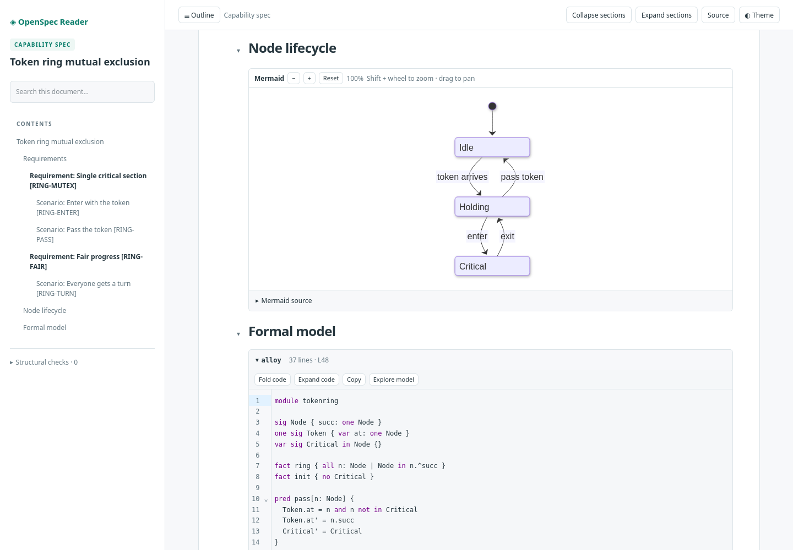

Mermaid diagrams render in the page, with zoom and pan. Alloy blocks have syntax highlighting, structural folding, and an **Explore model** button. The button opens the Alloy explorer, where you can step through solver results.

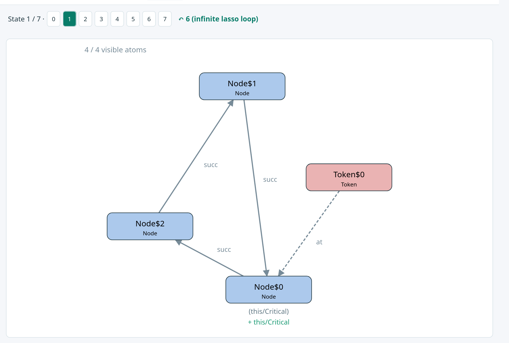

- **Graph:** layered or force-directed layouts, colors by type, and atoms that stay in position during trace playback. Green and red markers show what changed in each step.
- **Timeline:** each atom has a lane and each transition has a band, so you can read a trace step by step, for example `Token$0: at {Node$0} → {Node$2}`.
- **Table, adjacent-state comparison, focus and projection filters, search, and pattern finding.** You can also save snapshots, export bundles, and export SVG images.
- **Two ways to get results.** Import Alloy XML (for example, from CI) with nothing else installed. Or connect your project's own Alloy 6 JAR to run `run`/`check` commands, request other solutions, and evaluate expressions at any state.

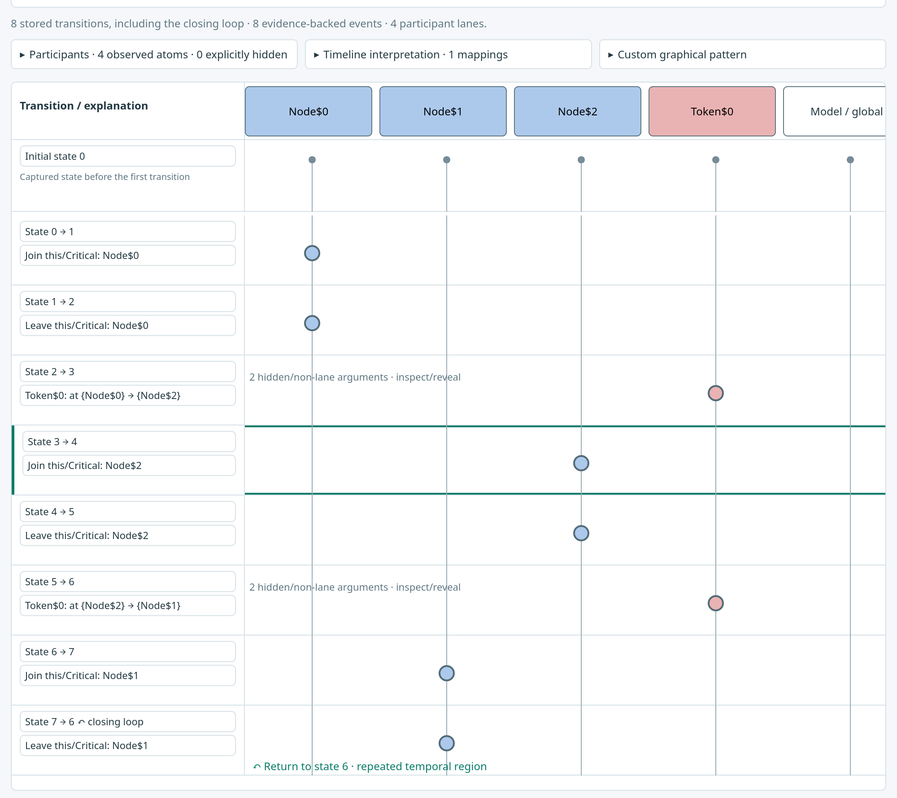

### Java and OpenJML, documented in place

<p>
  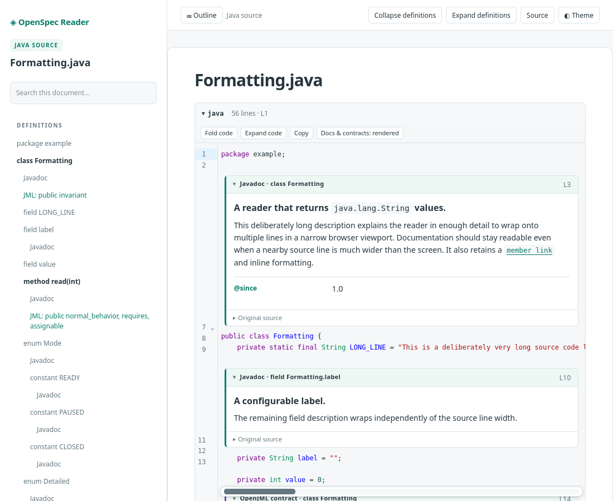
  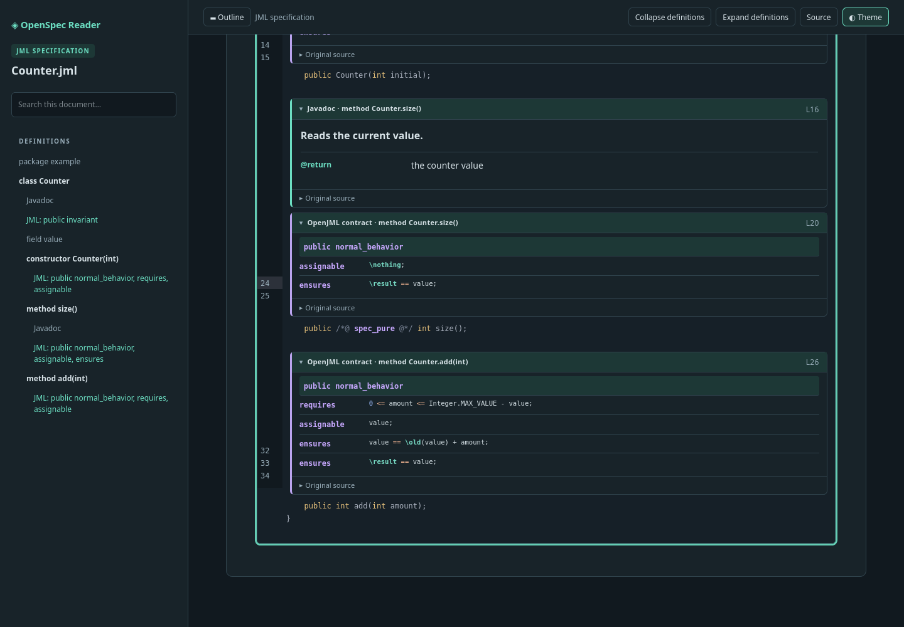
</p>

- **Javadoc as cards**, with a summary sentence, wrapped prose, `@param`/`@return`/`@throws` tags, and links to members in the same file.
- **OpenJML contracts as clause rows** for `requires`, `ensures`, `assignable`, loop invariants, and class invariants. `\result`, `\old`, and quantifiers are highlighted.
- **A declaration outline** that shows nested types, overloads, fields, model/ghost declarations, and contracts. Documented simple enums are shown as tables.
- Alloy `.als` files also get a definition outline for signatures, facts, predicates, assertions, and commands.

### Made for long documents

- Outline navigation and heading links that you can share.
- Search (**Ctrl+Shift+F**, or **Cmd+Shift+F** on macOS) that also finds matches inside collapsed sections and folded code.
- Collapse sections or whole code blocks. In Alloy, TypeScript, JavaScript, Java, and Rust you can also fold classes, methods, loops, and comments. Python, JSON, CSS, HTML, XML, YAML, SQL, and Markdown are also highlighted and foldable.
- The extension remembers your folds and scroll position for each document.
- Light and dark themes, comfortable and wide layouts, and a **Source** button that shows the original text.

### Private and read-only by design

- Everything runs in your browser. There is no server, no telemetry, and no CDN; all libraries are bundled.
- The extension never edits your files. Document HTML and diagram SVG are sanitized.
- Access to websites is opt-in for each site. The Alloy bridge is optional, and it asks for permission only when you connect it.

## Quick start

> **Signed builds are coming soon.** One-click installs will be published on [GitHub Releases](https://github.com/ohpauleez/openspec-reader/releases). Until then, you can build from source in about a minute.

You need Node.js 22.12+, npm, and Firefox 142+.

```sh
git clone https://github.com/ohpauleez/openspec-reader.git
cd openspec-reader
npm ci
npm run build
```

1. In Firefox, open `about:debugging#/runtime/this-firefox`. Select **Load Temporary Add-on…** and choose `dist/manifest.json`.
2. Open the extension's popup (from its toolbar button or the Extensions menu) and select **Enable local files**.
3. On Firefox 153 or later, also go to `about:addons` → **OpenSpec Markdown Reader** → **Permissions** and turn on **Allow access to file URLs**.
4. Open the demo spec: `firefox "$PWD/docs/demo/token-ring/spec.md"`. You can also paste its `file:///` URL into the address bar.

Firefox removes temporary add-ons when it closes. Load it again from `about:debugging`, or use `npm start` for a disposable development session.

**Does Firefox download the file instead of showing it? (Linux)** Add this line to `~/.mime.types` (merge it with any existing entries), then restart Firefox:

```text
type=text/plain exts=md,mkd,mkdn,mdwn,mdown,markdown,mdtxt,mdtext,als,java,jml desc="Markdown and source documents"
```

The [guide](GUIDE.md#linux-mime-setup) covers Snap installs and other setups.

## Take the two-minute tour

The repository includes a small demo, [`docs/demo/token-ring/spec.md`](docs/demo/token-ring/spec.md). It has two requirements, three scenarios, a Mermaid state diagram, and an Alloy model of token-ring mutual exclusion.

1. **Read it.** Collapse a requirement, use the outline to move around, and press **Ctrl+Shift+F** to search.
2. **Select Source** to see the plain Markdown that you started with.
3. **Explore the model.** Go to *Formal model* and select **Explore model**.
4. **Run it** (optional; Linux/macOS, a Java 17+ JDK, and an Alloy 6 JAR):

   ```sh
   npm run alloy:install -- --jar /absolute/path/to/alloy-6.jar
   ```

   Select **Connect local Alloy**, then **Load commands**, then **Run / check**. `everyoneGetsATurn` finds a looping trace in which every node takes a turn. Step through it in **Graph** and **Timeline**. Then select `check mutualExclusion` in the command list and select **Run / check** again. The result *No counterexample found* means that, with up to 4 nodes and 12 steps, no state has two nodes in their critical sections at the same time.

No Alloy installation? Use **Import result / saved bundle** to load an Alloy XML instance or trace, for example from CI. Playback, graphs, tables, and the timeline all work without Java.

## Supported files

| File | What you get |
|---|---|
| Markdown (`.md`, `.markdown`, …) | GitHub-flavored Markdown with tables, task lists, sanitized HTML, Mermaid diagrams, and foldable code |
| OpenSpec `spec.md`, `proposal.md`, `design.md`, `tasks.md` | Requirement and scenario cards, EARS/RFC 2119/Gherkin highlighting, delta sections, task progress, and structural checks |
| Alloy `.als` | Highlighted, foldable source with a definition outline and the model explorer |
| Java `.java`, OpenJML `.jml` | Javadoc and contract cards, enum tables, and a declaration outline |
| Text documents on websites | The same rendering. Turn it on for each site from the extension popup |

<details>
<summary><strong>More screenshots</strong></summary>

**EARS clause layout.** Each clause is on its own line, and only the system name is underlined.

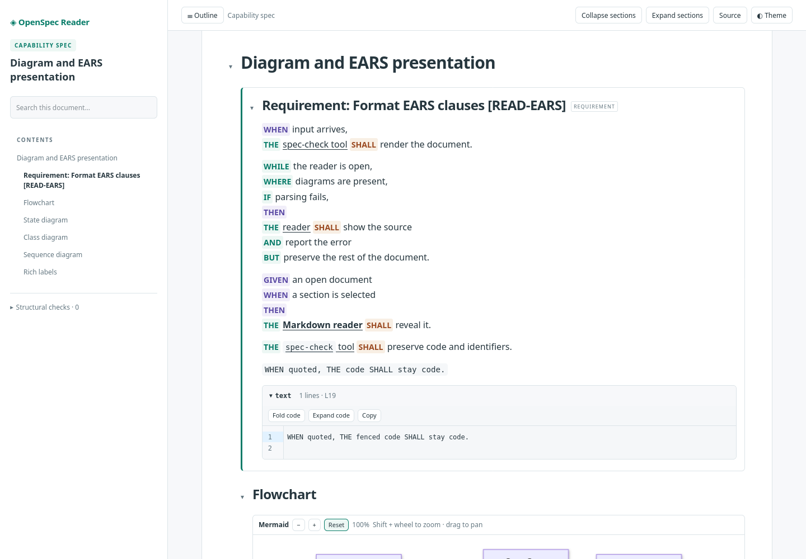

**Mermaid diagrams** with zoom controls, Shift+wheel zoom, drag to pan, and collapsible source.

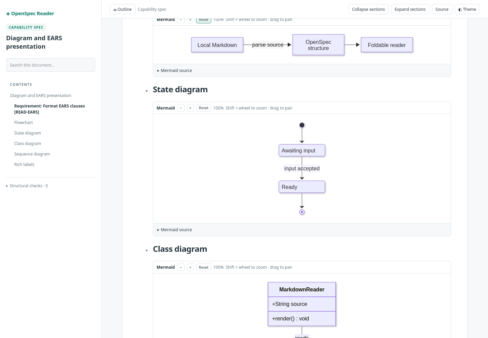

**A delta spec in dark theme** with task progress, an `ADDED Requirements` section, and a folded Alloy block.

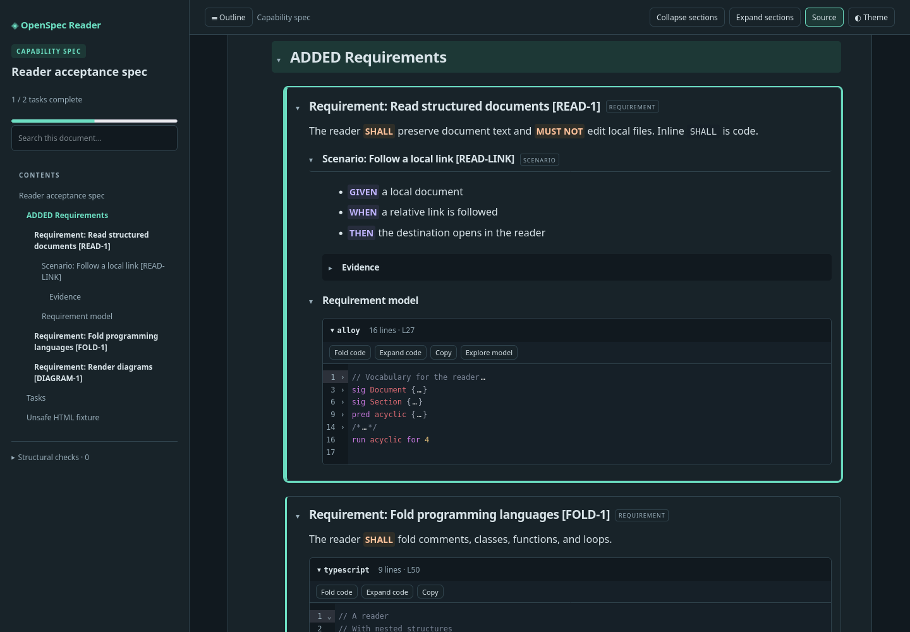

**Alloy source files** with a definition outline of facts, assertions, and run/check commands.

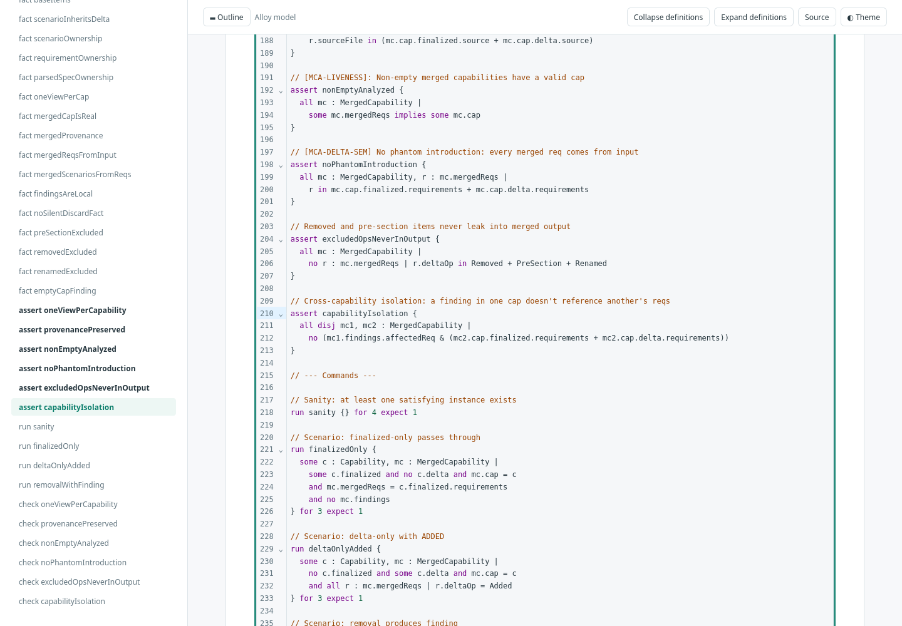

**Java contracts and loop specifications.**

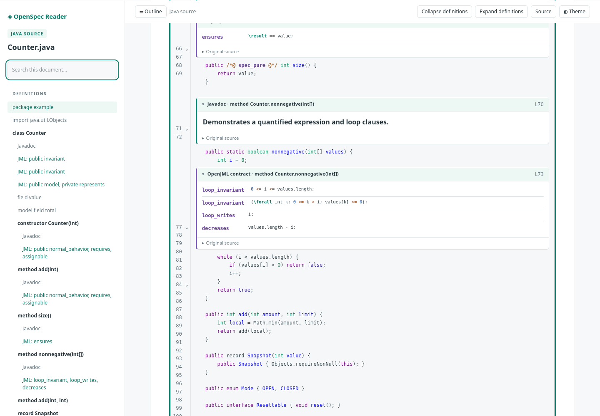

**Documented enums as tables.**

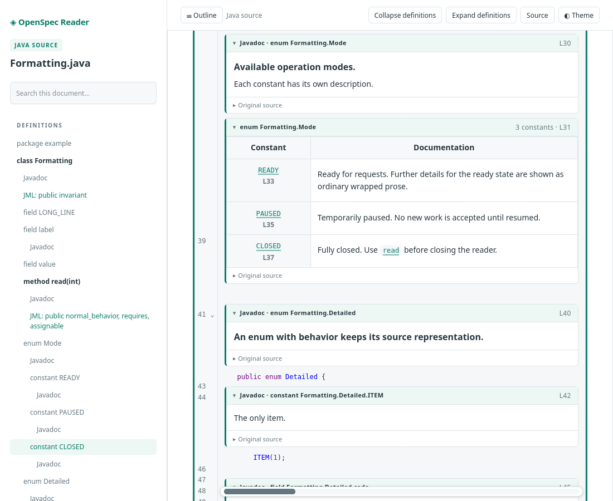

</details>

## Learn more

- **[GUIDE.md](GUIDE.md):** the full feature reference, reading controls, the Alloy explorer and Timeline in detail, limits, testing, and source layout.
- **[DESIGN.md](DESIGN.md):** design invariants and failure behavior.
- **[native/README.md](native/README.md):** the optional local Alloy bridge.

## Development

```sh
npm run check          # strict TypeScript, unit/property/corpus tests, production build
npx playwright install firefox
npm run test:browser   # end-to-end tests with the real extension in Firefox
```

For the full test matrix and source layout, see [Development and verification](GUIDE.md#development-and-verification) in the guide.

## License

MIT. Bundled libraries keep their own licenses. `npm run build` generates `dist/THIRD_PARTY_NOTICES.md` from the bundled packages.
