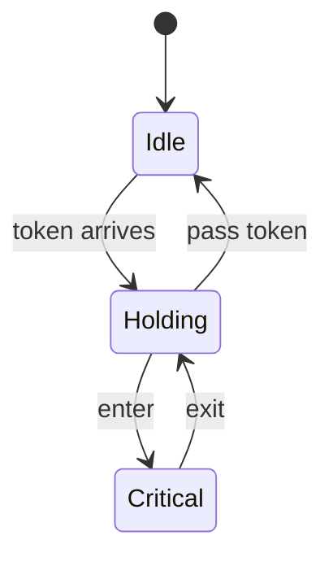

# Token ring mutual exclusion

Nodes arranged in a ring share a single token. Only the node holding the token may enter its critical section, so two nodes are never critical at the same time.

## Requirements

### Requirement: Single critical section [RING-MUTEX]

WHEN a node holds the token, THE token ring SHALL admit at most one node to its critical section.
WHILE a node is critical, THE token ring MUST NOT pass the token.

#### Scenario: Enter with the token [RING-ENTER]

WHEN node A holds the token and requests its critical section, THE token ring SHALL admit node A.
IF a node without the token requests its critical section, THEN THE token ring SHALL keep that node out of its critical section.

#### Scenario: Pass the token [RING-PASS]

WHEN node A passes the token, THE token ring SHALL give the token to the successor of node A.
IF node A is in its critical section, THEN THE token ring SHALL keep the token at node A.

### Requirement: Fair progress [RING-FAIR]

WHILE the ring is running, THE token ring SHOULD eventually give every node a turn.

#### Scenario: Everyone gets a turn [RING-TURN]

WHEN the token circulates, THE token ring SHALL eventually admit each node to its critical section.
IF a node does not need its critical section, THEN THE token ring MAY pass the token to its successor.

## Node lifecycle



## Formal model

```alloy
module tokenring

sig Node { succ: one Node }
one sig Token { var at: one Node }
var sig Critical in Node {}

fact ring { all n: Node | Node in n.^succ }
fact init { no Critical }

pred pass[n: Node] {
  Token.at = n and n not in Critical
  Token.at' = n.succ
  Critical' = Critical
}

pred enter[n: Node] {
  Token.at = n and n not in Critical
  Critical' = Critical + n
  Token.at' = Token.at
}

pred exit[n: Node] {
  n in Critical
  Critical' = Critical - n
  Token.at' = Token.at
}

fact transitions { always some n: Node | pass[n] or enter[n] or exit[n] }

// [RING-TURN] Each node eventually becomes critical.
run everyoneGetsATurn {
  all n: Node | eventually n in Critical
} for exactly 3 Node, 12 steps

// [RING-MUTEX] No counterexample means no reachable state with two critical nodes.
assert mutualExclusion { always lone Critical }
check mutualExclusion for 4 but 12 steps
```
