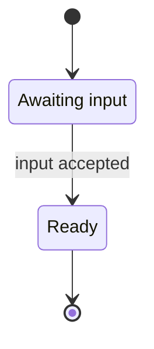
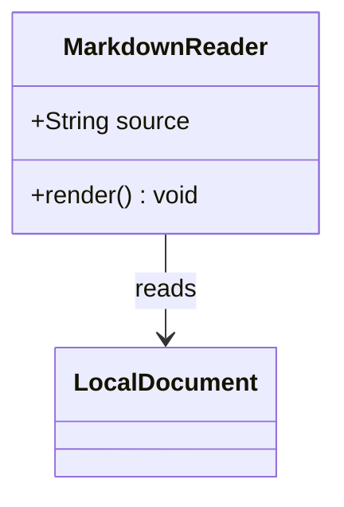
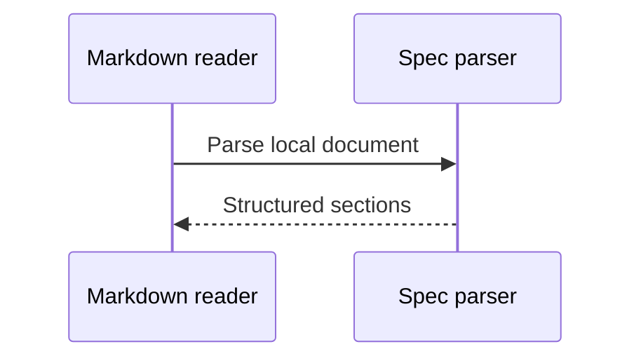
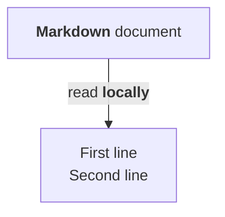

# Diagram and EARS presentation

## Requirement: Format EARS clauses [READ-EARS]

WHEN input arrives, THE spec-check tool SHALL render the document.

WHILE the reader is open, WHERE diagrams are present, IF parsing fails, THEN THE reader SHALL show the source AND report the error BUT preserve the rest of the document.

GIVEN an open document WHEN a section is selected THEN THE **Markdown reader** SHALL reveal it.

THE `spec-check` tool SHALL preserve code and identifiers.

`WHEN quoted, THE code SHALL stay code.`

```text
WHEN quoted, THE fenced code SHALL stay code.
```

## Flowchart


## State diagram



## Class diagram



## Sequence diagram



## Rich labels


