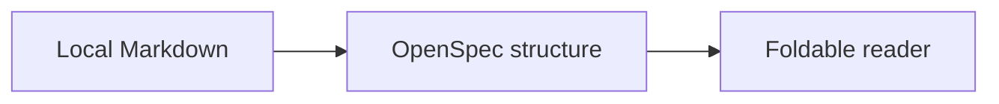

# Reader acceptance spec

Local [relative navigation](./linked.md) and an image: .

## ADDED Requirements

### Requirement: Read structured documents [READ-1]

The reader SHALL preserve document text and MUST NOT edit local files. Inline `SHALL` is code.

#### Scenario: Follow a local link [READ-LINK]

- **GIVEN** a local document
- **WHEN** a relative link is followed
- **THEN** the destination opens in the reader

##### Evidence

Evidence should remain collapsible. Search target: hidden-evidence-needle.

#### Requirement model

```alloy
// Vocabulary for the reader
// Each document has sections
sig Document {
  sections: set Section
}
sig Section {
  children: set Section
}
pred acyclic {
  all s: Section | {
    s not in s.^children
  }
}
/* A multiline
   comment */
run acyclic for 4
```

### Requirement: Fold programming languages [FOLD-1]

The reader SHALL fold comments, classes, functions, and loops.

```typescript
// A reader
// With nested structures
class Reader {
  read(text: string): void {
    for (const character of text) {
      console.log(character);
    }
  }
}
```

```javascript
class Reader {
  read(text) {
    while (text.length > 0) {
      text = text.slice(1);
    }
  }
}
```

```java
class Reader {
  void read(String text) {
    for (int i = 0; i < text.length(); i++) {
      System.out.println(text.charAt(i));
    }
  }
}
```

```rust
impl Reader {
  fn read(&self, text: &str) {
    for character in text.chars() {
      println!("{}", character);
    }
  }
}
```

### Requirement: Render diagrams [DIAGRAM-1]

The reader SHALL show Mermaid diagrams.



## Tasks

- [x] Render documents
- [ ] Review the reader

## Unsafe HTML fixture

<script>window.osrUnsafe = true;</script>

<a href="javascript:window.osrUnsafe=true">Unsafe link</a>
<div id="read-1" data-osr-fence="code-0">Document HTML cannot impersonate reader controls.</div>
